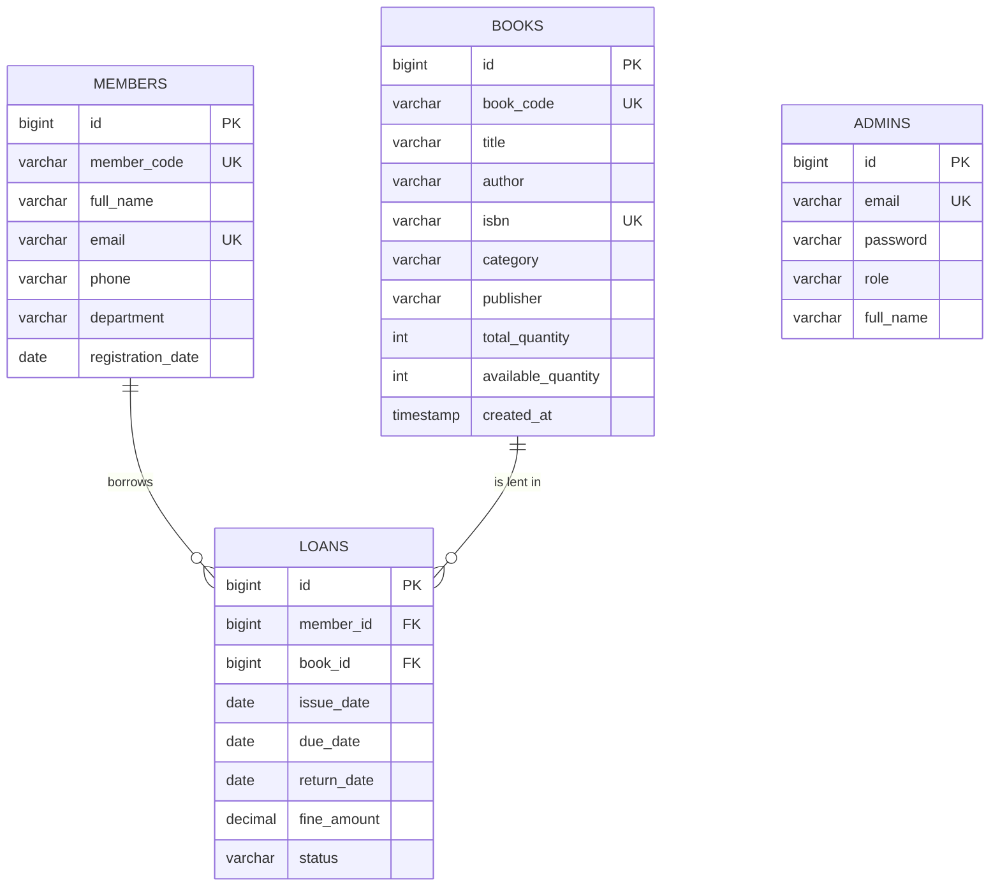

# LibraTrack — Smart Library Management System

LibraTrack is a web application that lets a library administrator manage **books, members, book issues and returns, due dates, overdue fines, transaction history and analytics**.
It was built for the *Agile Development Methodologies* course as a complete, working Spring Boot application with an H2 database and a JUnit 5 test suite.

---

## 1. Technology stack

| Layer | Technology |
|---|---|
| Language | Java 17 |
| Framework | Spring Boot 3.3 (Spring MVC, Spring Data JPA / Hibernate, Spring Security, Bean Validation) |
| Views | Thymeleaf, HTML5, CSS3 (custom design system), Bootstrap 5, vanilla JavaScript |
| Icons & charts | Bootstrap Icons, Chart.js (with offline fallbacks bundled — see §9) |
| Database | H2, persistent file mode (`./data/libratrack.mv.db`) |
| Testing | JUnit 5, Mockito, Spring Boot Test, MockMvc, Spring Security Test |
| Build | Maven |

## 2. Features

| Module | What it does |
|---|---|
| **Login** | Split-screen sign-in page, server-side authentication with Spring Security, BCrypt-hashed passwords, show/hide password, *Remember me*, logout. Every other page requires login. |
| **Dashboard** | Six live statistic cards (total books, members, books issued, available books, overdue books, pending fines), 6-month *Book Issue Trend* chart, *Recent Activities*, *Popular Books*, *Quick Actions*. All numbers come from the database. |
| **Books** | Add, edit, view details, delete, search (title/author/ISBN/ID), filter by category and availability, pagination. Status badges: **Available**, **Low Stock**, **Issued**, **Out of Stock**. |
| **Members** | Register, edit, view profile with borrowing history, delete, search, filter by department. |
| **Circulation** | *Issue Book* tab (member & book pickers with type-to-filter, issue/due dates, live borrowing-limit indicator) and *Return Book* tab (currently issued books, search by member ID / name / book title, due date, overdue status, fine if returned today, one-click return with receipt). |
| **Transactions** | Full history with transaction ID, member, book, issue/due/return dates, fine and status (ISSUED / OVERDUE / RETURNED); search, status filter, issue-date range filter, newest/oldest sorting, pagination. |
| **Reports** | Totals, monthly issues (12 months), fines collected per month, most-borrowed books, titles per category, overdue list, total fines collected, **print-friendly report**. |
| **Settings** | Change display name, change password, view the library rules, link to the H2 console. |

UI details: consistent sidebar and header, collapsible sidebar on small screens, confirmation dialogs before deletes and returns, toast notifications after actions, loading spinners on submit buttons, empty states, inline form validation, overdue alerts in the bell menu.

### Business rules (enforced in the service layer)

* ISBN must be unique; title cannot be empty; quantity must be positive; available copies cannot exceed the total quantity.
* Member ID and email must be unique; email and 10-digit phone must be valid; required fields cannot be empty.
* Only registered members can borrow; only books with a copy on the shelf can be issued.
* A member can hold **at most 3 books** at a time and cannot borrow two copies of the same title.
* Default loan period is **14 days**; the available quantity goes down on issue and up on return.
* **Fine = overdue days × ₹5**; returned on or before the due date → ₹0.
* A loan cannot be returned twice.
* Books and members with active loans cannot be deleted.

## 3. Architecture

```
Browser ──► Controller (thin, Spring MVC) ──► Service (business rules) ──► Repository (Spring Data JPA) ──► H2
                 │                                   │
            Thymeleaf views                     DTOs / exceptions
```

```
src/main/java/com/example/library/
├── LibraryManagementApplication.java
├── config/       SecurityConfig, DataInitializer (sample data), AppConfig (Clock), OverdueStatusScheduler
├── controller/   Auth, Dashboard, Book, Member, Circulation, Transaction, Report, Settings controllers
│                 + GlobalModelAdvice (header data) + WebSupport
├── model/        Book, Member, Loan, Admin, LoanStatus
├── repository/   BookRepository, MemberRepository, LoanRepository, AdminRepository
├── service/      BookService, MemberService, CirculationService, FineService, DashboardService,
│                 ReportService, AdminService (also the Spring Security UserDetailsService)
├── dto/          IssueBookRequest, ReturnBookResponse, BookRow, MemberRow, BookStatus, DashboardStats, ...
└── exception/    BusinessException, ResourceNotFoundException, GlobalExceptionHandler

src/main/resources/
├── application.properties
├── templates/    fragments/layout.html, auth/, books/, members/, circulation/, transactions/, reports/, settings/, dashboard.html, error.html
└── static/       css/ (base, layout, components, pages, print, icons-offline), js/ (app.js, charts.js), images/, vendor/
```

Design choices worth mentioning in the viva:

* **Constructor injection** everywhere; controllers only translate HTTP ↔ service calls.
* All rules live in services, so they are unit-testable with Mockito and cannot be bypassed by the UI.
* A `java.time.Clock` bean is injected into services, so tests can freeze "today".
* `BusinessException` carries the form field it relates to, so errors appear next to the right input.
* Overdue status is derived from the due date (always correct) and a scheduler also updates the stored status nightly.

## 4. Database

H2 runs in **file mode** (`jdbc:h2:file:./data/libratrack`), so data survives restarts. Tables are created by Hibernate (`ddl-auto=update`).



* `Loan` → `Member` and `Loan` → `Book` are `@ManyToOne` (not null); `Book` and `Member` have the inverse `@OneToMany(mappedBy=...)`.
* Deleting a book/member is refused while it has active loans (service rule). When allowed, its returned-loan history is removed with it.

**H2 console:** sign in to LibraTrack, then open <http://localhost:8080/h2-console>
JDBC URL `jdbc:h2:file:./data/libratrack`, user `sa`, empty password.

**Sample data** is inserted only on the very first start (when the tables are empty): 20 books in all six categories, 12 members, 64 loans spread over six months (14 still out, 3 of them overdue). Restarting never duplicates it. To reset everything, stop the app and delete the `data` folder.

## 5. How to run

**Prerequisites:** JDK 17 or newer, and either Maven 3.9+ or an IDE with Maven support (IntelliJ IDEA, Eclipse, VS Code). The first build needs internet access to download dependencies.

**Option A – IntelliJ IDEA (easiest)**
1. *File → Open* → select the `libratrack` folder (the one containing `pom.xml`). Wait for Maven to import.
2. Open `LibraryManagementApplication.java` and click the green ▶ *Run* button.
3. Browse to <http://localhost:8080>.

**Option B – command line**
```bash
cd libratrack
mvn spring-boot:run
```
Then open <http://localhost:8080>.

To build a runnable jar: `mvn clean package` then `java -jar target/libratrack-1.0.0.jar`.

## 6. Demo credentials

| Email | Password |
|---|---|
| `admin@libratrack.com` | `admin123` |

The login page also has a **Use demo** button that fills these in. The password is stored as a BCrypt hash, never in plain text.

## 7. Running the tests

```bash
mvn clean test
```
In IntelliJ: right-click `src/test/java` → *Run 'All Tests'*.

| Test class | Type | What it checks |
|---|---|---|
| `FineServiceTest` (11) | Unit | no fine before/on due date; ₹5 / ₹25 / ₹50 for 1 / 5 / 10 days; month boundary; invalid/missing dates |
| `BookServiceTest` (13) | Unit + Mockito | add book, duplicate ISBN, empty title, quantity rules, search by title, availability filter & badges, update, delete with/without active loans |
| `MemberServiceTest` (12) | Unit + Mockito | register, duplicate member ID, invalid email/phone, required fields, find by id/ID, update, duplicate email on update, delete guard |
| `CirculationServiceTest` (11) | Unit + Mockito | issue available book, quantity decreases, unavailable book, unregistered member, 3-book limit, due-date rule, return, quantity increases, overdue fine, duplicate return |
| `DashboardServiceTest` (8) | Unit + Mockito | total books, members, active loans, overdue loans, pending fines, combined stats, monthly trend |
| `CirculationIntegrationTest` (5) | Spring Boot + H2 | seed data & hashed password, full issue→late return→fine flow, borrowing limit, delete guards, every JPQL query |
| `WebIntegrationTest` (12) | Spring Boot + MockMvc | login redirect, demo login, wrong password, every page renders, 404 page, add-book form, validation errors, issue form, limit error on form |

## 8. Suggested viva demonstration (5 minutes)

1. **Login** with the demo account → dashboard shows live figures and the issue-trend chart.
2. **Books** → filter *Status: Issued* (AI: A Modern Approach, all 3 copies out) and *Out of Stock* (SQL: The Complete Reference). Add a book with a duplicate ISBN `9780132350884` → inline error.
3. **Circulation → Issue Book** → choose *STU101 – Ananya Verma*: the indicator shows the 3-book limit is reached; issuing is refused with a clear message. Issue a book to another member → toast + stock goes down.
4. **Return Book** → return one of the overdue loans (e.g. Vikram Rao, ~10 days late) → receipt shows the fine = days × ₹5.
5. **Transactions** → filter *Overdue* / *Returned*, search by member ID.
6. **Reports** → charts and *Print report*.
7. Show `mvn clean test` passing and the H2 console tables.

## 9. Offline demo

The pages load Bootstrap, Bootstrap Icons, Google Fonts and Chart.js from CDNs. If the demo machine is **offline**, LibraTrack falls back automatically to copies bundled in `static/vendor` (Bootstrap 5.3 CSS/JS, an icon font mapped onto the same icons) and to a built-in canvas renderer for the charts — so every page and chart still works. Only the web fonts fall back to system fonts.

## 10. Agile sprint breakdown

Details (user stories, acceptance criteria, Definition of Done) are in [`docs/AGILE.md`](docs/AGILE.md); the requirements are in [`docs/SRS.md`](docs/SRS.md).

| Sprint | Goal | Delivered |
|---|---|---|
| **1** | Requirements & design | Requirement gathering, SRS, database design (ER model), layered architecture, UI direction from the reference design |
| **2** | Secure core | Admin login (Spring Security + BCrypt), dashboard with live statistics, book management (CRUD, search, filters, badges) |
| **3** | Members & circulation | Member management, issue book (limit/availability rules), return book |
| **4** | Fines & insight | Fine calculation (₹5/day), transaction history with filters, reports & charts, print view |
| **5** | Quality | JUnit 5 + Mockito unit tests, Spring Boot integration tests, bug fixing, UI polish, offline fallbacks, documentation |

## 11. Troubleshooting

* **Port 8080 already in use** → change `server.port` in `application.properties`.
* **Want fresh sample data** → stop the app, delete the `data` folder, start again.
* **"Database may be already in use"** → another LibraTrack instance is running; stop it first.

---
Third-party assets bundled for offline use: Bootstrap 5.3.2 (MIT, Bootswatch build), Font Awesome Free 7 solid font (SIL OFL 1.1 / CC BY 4.0, licence in `static/vendor/fontawesome`).
